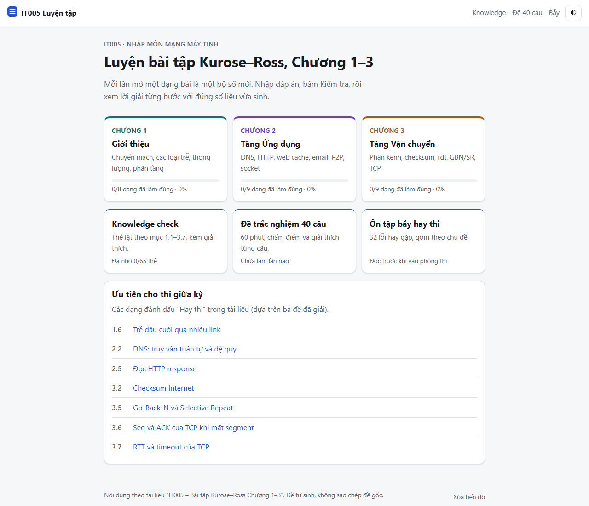
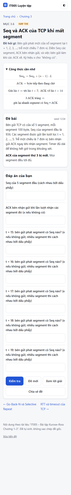
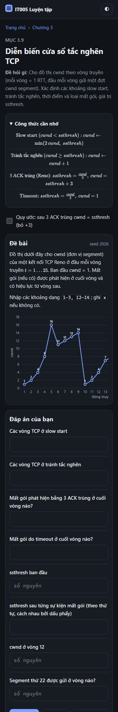

# IT005 Luyện tập: bài tập Kurose–Ross Chương 1–3

Web app tĩnh để luyện thi giữa kỳ môn *Nhập môn mạng máy tính*. Mỗi dạng bài sinh số liệu ngẫu nhiên theo seed, chấm đáp án và hiện lời giải từng bước với đúng số liệu vừa sinh. Nội dung, công thức và quy ước bám theo tài liệu *IT005 – Bài tập Kurose–Ross Chương 1–3* (file PDF chỉ giữ trên máy, không đưa lên repo; app không cần nó để chạy).

Vite + React + TypeScript, công thức hiển thị bằng KaTeX, test bằng Vitest. Không có backend.

## Chạy trên máy

```bash
npm install
npm run dev        # http://localhost:5173
npm test           # 132 test
npm run build      # xuất ra dist/
npm run preview    # xem thử bản build
```

## Deploy lên GitHub Pages

1. Đẩy code lên nhánh `main` của một repo GitHub.
2. Vào **Settings → Pages → Build and deployment**, chọn *Source: GitHub Actions*.
3. Workflow `.github/workflows/deploy.yml` sẽ chạy test, build và đăng `dist/` mỗi lần push.

`vite.config.ts` đặt `base: './'` và app dùng hash routing (`#/p/<id>?seed=...`), nên chạy được ở bất kỳ đường dẫn con nào (`https://<user>.github.io/<repo>/`) mà không cần cấu hình 404.

## Cấu trúc

| Đường dẫn | Nội dung |
|---|---|
| `src/generators/<id>.ts` | Mỗi dạng bài xuất `{ generate(seed), solve(params), explain(params), view(params) }` |
| `src/lib/rng.ts` | `rng(seed)` (mulberry32), không dùng thư viện ngẫu nhiên ngoài |
| `src/lib/grade.ts` | Đọc số (dấu phẩy/chấm, `1.6e-4`, `1,6×10^-4`, `25%`, `vô hạn`), chấm sai số 1%, gợi ý lỗi hay gặp |
| `src/lib/storage.ts` | Tiến độ trong `localStorage`, bọc try/catch, tự chuyển sang bộ nhớ tạm nếu bị chặn |
| `src/data/` | Knowledge check, 40 câu trắc nghiệm (Chương 5 + Phụ lục B), các hộp “Bẫy hay gặp” |
| `tests/` | Test tái tạo ví dụ trong PDF, chạy mọi dạng với 40 seed, kiểm tra mọi chuỗi TeX |

Chia sẻ một đề: bấm **Chia sẻ đề** để chép link dạng `#/p/end-to-end-delay?seed=1234`.

## Các dạng bài (26)

**Chương 1:** `circuit-switching`, `ps-vs-cs`, `caravan`, `one-hop-delay`, `queuing-delay`, `end-to-end-delay`, `throughput`, `layering`
**Chương 2:** `dns-cache`, `dns-iter-rec`, `dns-http-delay`, `http-request`, `http-response`, `web-cache`, `email`, `p2p`, `sockets`
**Chương 3:** `mux-demux`, `checksum`, `rdt`, `utilization`, `gbn-sr`, `tcp-seq-ack`, `tcp-rtt`, `flow-control`, `cwnd`

Ngoài ra: Knowledge check dạng thẻ lật (65 thẻ, mục 1.1–1.5, 2.1–2.4, 2.7, 3.1–3.7), đề 40 câu (60 phút, trộn câu và trộn phương án, lưu lịch sử điểm, làm dở vẫn tiếp tục được sau khi tải lại trang), trang ôn bẫy (32 bẫy, 7 chủ đề).

## Quy ước tự chọn

Những chỗ PDF không nói rõ, app chọn như sau:

- **Đơn vị đáp án:** các bài trễ hỏi theo ms; `one-hop-delay` tự chọn µs/ms/s theo độ lớn. Ô số nguyên (cổng, Seq, số socket…) phải đúng tuyệt đối; ô số thực sai số 1%. Riêng `tcp-rtt` dùng sai số 0,2–0,5%, vì 1% của Timeout (khoảng 1,5 ms) quá rộng để phân biệt cách tính giáo trình với RFC 6298.
- **`dns-cache`:** local nhận yêu cầu lúc t+1 và xét cache tại thời điểm đó. Bản ghi lưu lúc s còn hiệu lực tới (không gồm) s + TTL. Bộ sinh đề loại các đề có thời điểm kiểm tra cách mốc lưu/hết hạn ≤ 1 đơn vị, để không có đề mơ hồ.
- **`web-cache`:** trễ của yêu cầu trượt cache là d_Internet + d_LAN (giống cả hai ví dụ số trong PDF), dù công thức tổng quát trong PDF chỉ ghi d_Internet.
- **`cwnd`:** vòng có cwnd vừa bằng ssthresh tính là tránh tắc nghẽn (khớp đáp án ví dụ trong PDF). ssthresh = ⌊cwnd/2⌋, và bộ sinh chỉ đặt sự kiện mất gói ở cwnd chẵn. Mất gói phát hiện cuối vòng, có hiệu lực từ vòng sau. Có công tắc “sau 3 ACK trùng cwnd = ssthresh”.
- **`tcp-seq-ack`:** segment mất luôn có chỉ số ≥ 2, để ACK đầu tiên chắc chắn là ACK “mới”. Gửi lại nhanh đúng ở ACK trùng thứ 3. Với kiểu “mất ACK”, ô ACK bên nhận vẫn ghi giá trị đã gửi (ACK mất trên đường về). Với chính sách “giữ”, các segment mới gửi trước lúc gửi lại nhanh đều đã tới khi segment gửi lại tới.
- **`gbn-sr`, mất ACK:** GBN không phải gửi lại gì, trừ khi ACK bị mất là ACK cuối của cửa sổ.
- **`rdt`:** lần gửi lại luôn thành công. Nếu pkt0 đầu tiên bị lỗi, bên nhận rdt2.2/3.0 gửi ACK1 (trạng thái khởi đầu của FSM).
- **`http-request`:** không có dòng Connection thì bền vững theo mặc định của phiên bản (1.1 có, 1.0 không). **`http-response`:** 304 có kích thước thân là 0.
- **`p2p`:** mọi peer cùng tốc độ upload u, nên Σuᵢ = N·u.
- **`tcp-rtt`:** mặc định theo giáo trình (cập nhật EstimatedRTT trước); có công tắc “theo RFC 6298”.
- **Đề 40 câu:** câu có phương án “Cả A và B” (câu 12) giữ nguyên thứ tự phương án khi trộn.
- **Knowledge check 1.4:** chữ trong PDF bị lỗi phông ở hai ô đáp án này; app ghi lại theo phép tính (12 µs và 96 µs).
- **Hiển thị:** KaTeX tự tách dấu tiếng Việt trong `\text{}` (dấu chồng hiển thị lệch), nên app chèn lại nguyên văn chữ tiếng Việt sau khi KaTeX render. Công thức hiển thị ở chế độ inline `\displaystyle` để xuống dòng được trên màn hình 360 px.

## Ảnh chụp

| Trang chủ (desktop) | Seq/ACK TCP (360 px) | cwnd (360 px, tối) |
|---|---|---|
|  |  |  |
